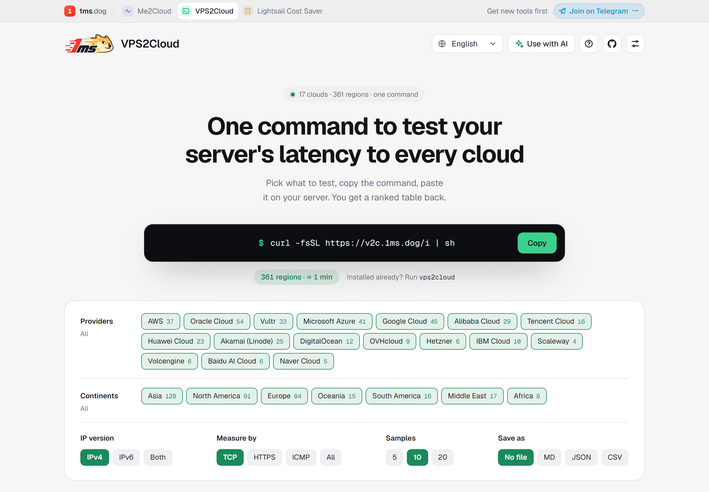
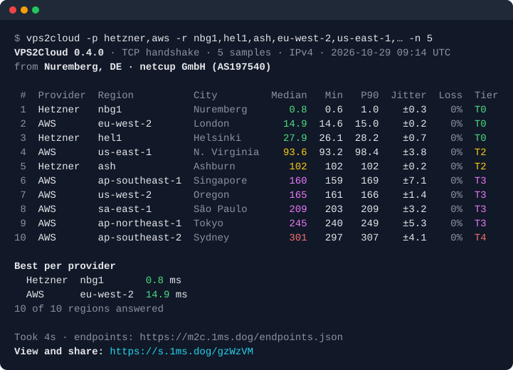

# VPS2Cloud

**English** · [简体中文](README.zh-CN.md)

Latency, jitter and loss from the machine you run it on to **361 regions of 17 cloud providers**: AWS, Azure, Google Cloud, Oracle, Alibaba Cloud, Tencent Cloud, Huawei Cloud, Akamai (Linode), DigitalOcean, Vultr, Hetzner, OVHcloud, IBM Cloud, Scaleway, Volcengine, Baidu AI Cloud and Naver Cloud.

One static binary, no dependencies, about a minute for all 361 regions. Run it on a VPS, a router or in CI to see which regions are close to it, then share the result as a link or paste it as a Markdown table. It speaks 10 languages.

It is the server-side companion of [Me2Cloud](https://m2c.1ms.dog), which runs the same test from your browser, and uses the same endpoint list.

<p align="center"><a href="https://v2c.1ms.dog"></a></p>

**Website: [v2c.1ms.dog](https://v2c.1ms.dog)**: pick providers, continents, IP version, measurement and samples, and it writes the command for you to copy; share links from the tool open there as a full, sortable result page.

<p align="center"></p>

## Fast

**Every region of 17 clouds in about a minute.** Measured on a 1 vCPU, 1 GB VPS in Nuremberg (netcup), October 2026:

| Run | Samples | Time |
|---|---:|---:|
| All 361 regions, TCP, 10 samples each (the default) | 3,610 | **1 min 14 s** |
| All 361 regions, 5 samples (`-n 5`) | 1,805 | **35 s** |
| IPv4 and IPv6 in one run (`--ip both`) | 4,570 | **1 min 29 s** |
| TCP, HTTPS and ICMP side by side (`-m all -n 5`) | 5,415 | **2 min 40 s** |
| A handful of regions (`-p hetzner,aws -r …`, 10 regions) | 50 | **4 s** |

It measures many regions at once (24 hosts in parallel by default) and a TCP sample is a single handshake, with no TLS or HTTP on top. Taking the same 3,610 samples one region after another, with the same pause, would take more than 20 minutes. Speed doesn't cost the providers anything extra: each host still gets one sample at a time with a pause in between (see [Gentle on providers](#gentle-on-providers)).

## Install

```sh
curl -fsSL https://v2c.1ms.dog/i | sh
```

`v2c.1ms.dog/i` serves the same script as this repository's release; the long form is

```sh
curl -fsSL https://github.com/yt1988/vps2cloud/releases/latest/download/install.sh | sh
```

The script picks the build for your OS and CPU, downloads it from this repository's latest release, checks it against the release's `checksums.txt`, installs it as `/usr/local/bin/vps2cloud` (or `~/.local/bin` without root) with `v2c` as a short alias, and starts the test with its menu. Add `sh -s -- --no-run` (or set `V2C_NO_RUN=1`) to install only; without a terminal, as in CI, it only installs. Read it first if you like: it is [install.sh](install.sh).

Install and run a test with options in one go (no menu):

```sh
curl -fsSL https://v2c.1ms.dog/i | sh -s -- -p aws,gcp --ip both
```

Run once without installing:

```sh
curl -fsSL https://v2c.1ms.dog/i | sh -s -- run
```

Or download a binary from [Releases](https://github.com/yt1988/vps2cloud/releases): Linux (amd64, arm64, armv7, 386, riscv64, mips, mipsle for OpenWrt), macOS, FreeBSD and Windows.

### Updates

At most every 12 hours, vps2cloud asks GitHub which release is the latest. In a terminal it then offers the update (`vps2cloud v0.5.0 is out (you have v0.4.0). Update now? [Y/n]`); on yes it downloads the build for your system, checks it against the release's `checksums.txt`, replaces itself and carries on with the same options. Without a terminal it only prints a one-line note. `vps2cloud --update` updates right away; `--offline` or `V2C_NO_UPDATE=1` turns the check off. When the binary sits where you can't write (`/usr/local/bin` without root), run the update with `sudo` or install again.

## Usage

Run `vps2cloud` in a terminal with no options and it asks what to test, step by step, in color; Enter keeps each default and 0 goes back a step (0 on the first question exits):

```
What to test?            all regions · choose providers · choose continents · language
IP version?              IPv4 · IPv6 · both in one run (asked when the machine has IPv6)
How to measure?          TCP handshake · HTTPS · ICMP · all three
Samples per region?      5 · 10 · 20
```

It then prints the options it used, so the same test runs again without the menu. With options, or when the output is not a terminal, there is no menu:

```sh
vps2cloud -m tcp                   # every region, TCP handshake, 10 samples (any option skips the menu)
vps2cloud -p aws,gcp -r 'eu-*'     # some providers, European regions
vps2cloud --continent as --top 10  # Asia, the 10 best
vps2cloud -m all -p hetzner        # TCP, HTTPS and ICMP side by side
vps2cloud -6                       # over IPv6 (regions without IPv6 are skipped and counted)
vps2cloud --ip both                # IPv4 and IPv6 in one run: one report with a part for each, one share link
vps2cloud --preset game            # mark regions that fit gaming (median ≤ 60 ms, jitter ≤ 10, no loss)
vps2cloud -o md                    # also save a Markdown table (vps2cloud-<date>-<time>.md) for a forum post
vps2cloud -o json --file out.json  # save JSON (or CSV) under a name of your choice
vps2cloud -o json --stdout | jq '.regions[0]'   # print it instead, for pipes
vps2cloud --max-ms 50              # exit status 3 when even the best region is above 50 ms
vps2cloud --list                   # providers; --list -p aws lists AWS's regions
```

`vps2cloud --help` lists every option. Or let [v2c.1ms.dog](https://v2c.1ms.dog) write the command: choose on the page, copy, paste.

### Language

The first time the menu runs it asks for a language (English, 简体中文, 繁體中文, 日本語, 한국어, Español, Français, Deutsch, Português, Русский) and remembers it in `~/.config/vps2cloud/config.json`. Change it later with the menu's last item, which is labelled in the current language and in English (for example `语言 / Language`), so you can always find your way back. For one run, use `--lang ja` or `V2C_LANG=ja`. The menu, the table and the Markdown follow the language; JSON and CSV keep English keys (each row names its `ip_family`). Colors appear only in a terminal; `--no-color` or `NO_COLOR` turns them off.

### What it measures

| Mode | What one sample is | Use it for |
|---|---|---|
| `tcp` (default) | A TCP handshake with the region's HTTPS port | Pure network round trip, no server work: the fairest comparison between regions |
| `https` | A request on an open, reused HTTPS connection, timed until the headers arrive | The same number Me2Cloud shows in a browser; includes a little server time |
| `icmp` | An ICMP echo | A classic ping. Some networks deprioritize ICMP, and Naver Cloud drops it |

Per region you get the median, minimum, P90, jitter (mean difference between consecutive samples), loss and a tier: T0 ≤ 30 ms, T1 ≤ 80, T2 ≤ 150, T3 ≤ 250, T4 above. The numbers are computed the same way as in Me2Cloud.

ICMP needs root, `CAP_NET_RAW` (`sudo setcap cap_net_raw+ep $(command -v vps2cloud)`) or a `net.ipv4.ping_group_range` that includes your group.

### Gentle on providers

Each host gets one sample at a time with a 250 ms pause in between, at most four hosts of one provider are measured at once, and a host is given up after three failures in a row. A default run sends each region ten handshakes.

## Privacy and what goes over the network

Besides the measurement itself, a run makes these requests:

- **The endpoint list** from `v2c.1ms.dog` (falling back to `m2c.1ms.dog`, then to the copy built into the binary). This request is how runs are counted: its User-Agent says `vps2cloud/<version> (<os>/<arch>[; ci])` and nothing else about the machine. `--offline` skips it.
- **Cloudflare's `/meta` and ident.me** to name the network the test runs from (city, provider, ASN) for the "from" line.
- **The short link service** `s.1ms.dog`, to turn the share link into a short one (see below).
- **The update check**, a request to `github.com/yt1988/vps2cloud/releases/latest` at most every 12 hours (see [Updates](#updates)). `--offline` or `V2C_NO_UPDATE=1` skips it.

The share link is short, like `https://s.1ms.dog/9eeaap`. It points to the full link, which carries the result itself: the per-region numbers and the "from" line (city, provider), never the IP address. To make the short link, the full link is stored on `s.1ms.dog` (a 1ms.dog service on Cloudflare), permanently, so the result can be opened later; the same result always gets the same short link. Nothing else is uploaded.

To keep the result off any server, use `--long-link`: you get the full link, which carries everything in the URL fragment (`#…`) that browsers do not send to a server (about 2,000 characters for all 361 regions, a few hundred for 20; the format is in [docs/share-format.md](docs/share-format.md)). `--offline` does the same, and when the short link service does not answer, the full link is shown. `--no-link` makes no link at all. The IP is only printed with `--show-ip`.

## Endpoints

The list lives in [Me2Cloud](https://github.com/yt1988/me2cloud) (`public/endpoints.json`), where each endpoint is checked weekly. A workflow here copies it daily into [`endpoints.json`](endpoints.json), which is built into the binary. Use your own list with `--endpoints FILE`; the format is documented in Me2Cloud.

What it cannot do: it measures each provider's public API or storage endpoint in a region, not a virtual machine, and it does not measure bandwidth.

## Verify a download

Every release lists SHA-256 checksums and carries GitHub build provenance, so you can check that a binary was built from this repository by its release workflow:

```sh
gh attestation verify vps2cloud-linux-amd64 --repo yt1988/vps2cloud
```

## Build

```sh
go build -o vps2cloud .
go test ./...
```

Go 1.27 or later. `golang.org/x/net` (for ICMP) is the only dependency.

## License

MIT
