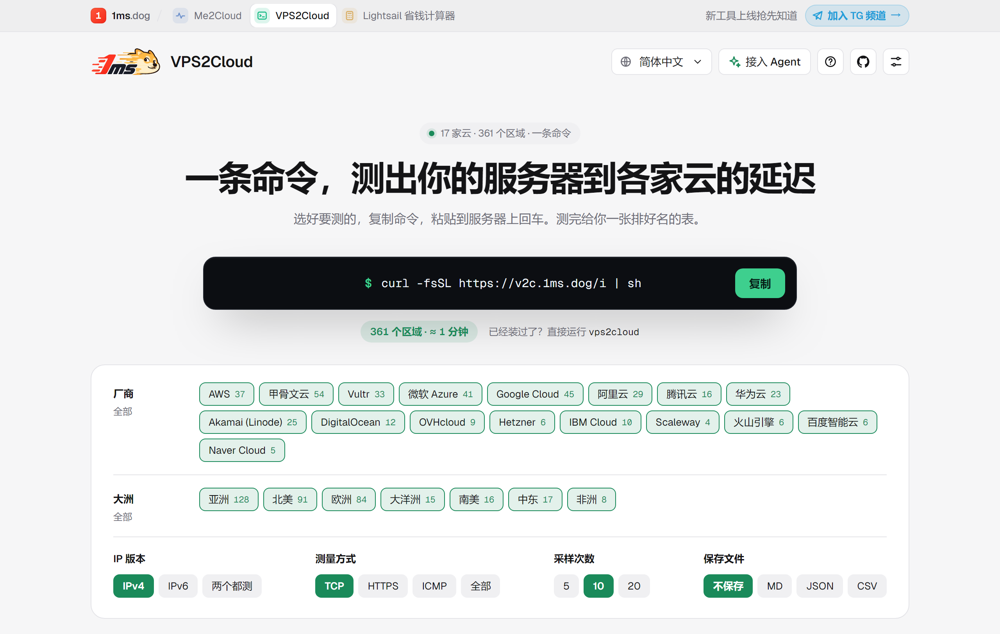
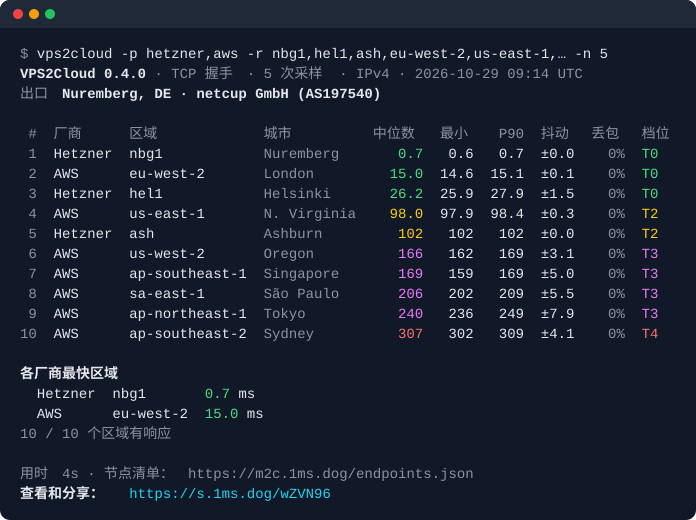

# VPS2Cloud

[English](README.md) · **简体中文**

在你运行它的机器上，测到 **22 家云厂商、392 个区域**的延迟、抖动和丢包：AWS、Azure、Google Cloud、Oracle、阿里云、腾讯云、华为云、Akamai（Linode）、DigitalOcean、Vultr、Hetzner、OVHcloud、IBM Cloud、Scaleway、火山引擎、百度智能云、Naver Cloud、IONOS Cloud、Aruba Cloud、Leaseweb、Gcore 和 Yandex Cloud。

单个静态二进制文件，没有任何依赖，全部 392 个区域一分钟左右测完。放在 VPS、路由器或 CI 里跑，就能看出哪些区域离它近；结果可以生成分享链接，也可以复制成 Markdown 表格贴到论坛。支持 10 种语言。

它是 [Me2Cloud](https://m2c.1ms.dog) 的服务器版：Me2Cloud 在浏览器里测你家网络到各家云的延迟，两者用的是同一份节点清单。

<p align="center"><a href="https://v2c.1ms.dog"></a></p>

**网站：[v2c.1ms.dog](https://v2c.1ms.dog)**：在页面上选厂商、大洲、IP 版本、测量方式和采样次数，自动生成命令，复制即可运行；工具输出的分享链接也在这里打开，看完整、可排序的结果页。

<p align="center"></p>

## 速度

**22 家云的全部区域，一分钟左右测完。** 在纽伦堡一台 1 核 1 GB 的 VPS（netcup）上实测，2026 年 10 月：

| 测试 | 采样数 | 用时 |
|---|---:|---:|
| 全部 392 个区域，TCP，每个 10 次（默认） | 3,920 | **1 分 16 秒** |
| 全部 392 个区域，每个 5 次（`-n 5`） | 1,960 | **35 秒** |
| IPv4 和 IPv6 一次测完（`--ip both`） | 4,900 | **1 分 33 秒** |
| TCP、HTTPS、ICMP 三种并排（`-m all -n 5`） | 5,880 | **2 分 42 秒** |
| 只测几个区域（`-p hetzner,aws -r …`，10 个区域） | 50 | **4 秒** |

快的原因：多个区域同时测（默认同时 24 个主机），TCP 方式的一次采样就是一次握手，不走 TLS 和 HTTP。同样 3,920 次采样、同样的间隔，一个区域接一个区域地测，要 20 分钟以上。快也不会给云厂商增加负担：每个主机仍然一次只有一个采样，两次之间有间隔（见[对云厂商友好](#对云厂商友好)）。

## 安装

```sh
curl -fsSL https://v2c.1ms.dog/i | sh
```

`v2c.1ms.dog/i` 提供的就是本仓库 Release 里的同一个脚本；完整写法是

```sh
curl -fsSL https://github.com/yt1988/vps2cloud/releases/latest/download/install.sh | sh
```

脚本会按你的系统和 CPU 选对应的版本，从本仓库最新的 Release 下载，用 Release 里的 `checksums.txt` 校验，安装到 `/usr/local/bin/vps2cloud`（没有 root 权限时装到 `~/.local/bin`），同时创建短别名 `v2c`，然后直接打开菜单开始测试。只想安装不运行，加 `sh -s -- --no-run`（或设置 `V2C_NO_RUN=1`）；在没有终端的环境（比如 CI）里只安装、不运行。想先看看脚本做了什么：就是 [install.sh](install.sh)。

安装后直接按参数跑一次测试（不出菜单）：

```sh
curl -fsSL https://v2c.1ms.dog/i | sh -s -- -p aws,gcp --ip both
```

只运行一次、不安装：

```sh
curl -fsSL https://v2c.1ms.dog/i | sh -s -- run
```

Windows 上，在 PowerShell 里运行：

```powershell
irm https://v2c.1ms.dog/i.ps1 | iex
```

它会安装到 `%LOCALAPPDATA%\Programs\vps2cloud`，把这个文件夹加进 PATH，然后打开菜单（[install.ps1](install.ps1)）。

也可以直接从 [Releases](https://github.com/yt1988/vps2cloud/releases) 下载：Linux（amd64、arm64、armv7、386、riscv64，以及 OpenWrt 用的 mips、mipsle）、macOS、FreeBSD 和 Windows。

安装脚本和程序自己的更新，都先从 `v2c.1ms.dog/dl/` 下载（它转发 GitHub Release 里的文件，因为国内访问 GitHub 常常很慢或连不上），失败了再从 GitHub 下载。无论从哪里下载，使用前都会用 Release 里的 `checksums.txt` 校验。

### 更新

vps2cloud 最多每小时查一次最新版本（问 `v2c.1ms.dog/v`，不通再问 GitHub）。在终端里运行时，发现新版本会询问是否更新（`发现新版本 v0.5.0（当前 v0.4.0），现在更新吗？[Y/n]`）；确认后下载适合你系统的版本，用 Release 里的 `checksums.txt` 校验，替换自身，然后用同样的参数继续运行。没有终端时只打印一行提示。`vps2cloud --update` 立即更新；`--offline` 或 `V2C_NO_UPDATE=1` 关闭检查。如果程序装在你没有写权限的位置（比如没有 root 时的 `/usr/local/bin`），用 `sudo` 运行更新，或重新安装。

## 用法

在终端里不带参数运行 `vps2cloud`，它会一步步问你要测什么（带配色），直接回车就是默认值，输入 0 返回上一步（第一个问题里 0 是退出）：

```
测什么？              全部区域 · 按厂商选 · 按大洲选 · 语言
IP 版本？             IPv4 · IPv6 · 两个一起测（本机有 IPv6 时才会问）
怎么测？              TCP 握手 · HTTPS · ICMP · 三种都测
每个区域采样几次？    5 · 10 · 20
```

测完会打印出这次用的参数，下次不用菜单就能直接跑同样的测试。带了参数，或者输出不是终端时，不会出菜单：

```sh
vps2cloud -m tcp                   # 全部区域，TCP 握手，10 次采样（带任何参数都会跳过菜单）
vps2cloud -p aws,gcp -r 'eu-*'     # 指定厂商，只测欧洲区域
vps2cloud --continent as --top 10  # 亚洲，只看最快的 10 个
vps2cloud -m all -p hetzner        # TCP、HTTPS、ICMP 三种并排
vps2cloud -6                       # 走 IPv6（没有 IPv6 的区域会跳过并计数）
vps2cloud --ip both                # IPv4 和 IPv6 一次测完：一份报告分两部分，一个分享链接
vps2cloud --preset game            # 标出适合打游戏的区域（中位数 ≤ 60 ms、抖动 ≤ 10、不丢包）
vps2cloud -o md                    # 同时保存一份 Markdown 表格（vps2cloud-<日期>-<时间>.md），方便贴论坛
vps2cloud -o json --file out.json  # 保存成 JSON（或 CSV），文件名自己定
vps2cloud -o json --stdout | jq '.regions[0]'   # 改为输出到屏幕，方便接管道
vps2cloud --max-ms 50              # 最快的区域也超过 50 ms 时，以退出码 3 结束
vps2cloud --list                   # 列出厂商；--list -p aws 列出 AWS 的全部区域
```

`vps2cloud --help` 列出所有参数。每个区域测完就立刻在 stderr 输出一行，全部测完再在 stdout 给出排好序的表。测到一半按 Ctrl-C，会停下来并显示已经测完的区域。也可以让 [v2c.1ms.dog](https://v2c.1ms.dog) 帮你写命令：在页面上选好，复制，粘贴。

### 语言

第一次打开菜单时会先让你选语言（English、简体中文、繁體中文、日本語、한국어、Español、Français、Deutsch、Português、Русский），选择会保存在 `~/.config/vps2cloud/config.json`，之后不再询问。以后想改，用菜单最后一项：它同时用当前语言和英语标注（比如 `语言 / Language`），即使切到了看不懂的语言也能找回来。只想临时换一次，用 `--lang ja` 或 `V2C_LANG=ja`。菜单、结果表格和 Markdown 都跟随语言；JSON 和 CSV 的字段名保持英文（每一行带 `ip_family` 标明 IP 版本）。颜色只在终端里显示，`--no-color` 或环境变量 `NO_COLOR` 可以关掉。

### 测的是什么

| 方式 | 一次采样是什么 | 适合 |
|---|---|---|
| `tcp`（默认） | 和区域的 HTTPS 端口完成一次 TCP 握手 | 纯网络往返，不含服务器处理时间，比较区域时最公平 |
| `https` | 在已建立、复用的 HTTPS 连接上发一次请求，计时到收到响应头 | 和 Me2Cloud 在浏览器里测出的数字一致，包含少量服务器处理时间 |
| `icmp` | 一次 ICMP 回显 | 传统 ping。部分网络会降低 ICMP 的优先级，Naver Cloud 不回 ICMP |

每个区域给出中位数、最小值、P90、抖动（相邻两次采样之差的平均值）、丢包和档位：T0 ≤ 30 ms、T1 ≤ 80、T2 ≤ 150、T3 ≤ 250，更高是 T4。计算方法和 Me2Cloud 完全一致。

ICMP 需要 root、`CAP_NET_RAW`（`sudo setcap cap_net_raw+ep $(command -v vps2cloud)`），或者 `net.ipv4.ping_group_range` 覆盖了你所在的用户组。

### 对云厂商友好

同一个服务器一次只测一个样本，样本之间间隔 250 ms；同一家厂商最多同时测 4 个区域；连续失败 3 次就放弃该区域。默认一次运行，每个区域只会收到 10 次握手。

## 隐私，以及会发出哪些请求

除了测量本身，每次运行会发出这些请求：

- **节点清单**：从 `v2c.1ms.dog` 获取（失败时改用 `m2c.1ms.dog`，再失败就用程序内置的清单）。运行次数就是靠这个请求统计的：它的 User-Agent 只写了 `vps2cloud/<版本> (<系统>/<架构>[; ci])`，不包含这台机器的任何其他信息。加 `--offline` 就不发这个请求。
- **Cloudflare 的 `/meta` 和 ident.me**：用来识别测试所在的网络（城市、运营商、ASN），显示在「出口」那一行。
- **短链服务** `s.1ms.dog`：把分享链接变短（见下文）。
- **检查更新**：最多每小时请求一次 `v2c.1ms.dog/v`（不通时改为 `github.com/yt1988/vps2cloud/releases/latest`，见[更新](#更新)）。加 `--offline` 或 `V2C_NO_UPDATE=1` 就不检查。

分享链接是短链，比如 `https://s.1ms.dog/9eeaap`。它指向完整链接，结果就在完整链接里：各区域的数值和「出口」那一行（城市、运营商），永远不包含 IP 地址。为了生成短链，完整链接会**永久保存**在 `s.1ms.dog`（1ms.dog 部署在 Cloudflare 上的服务）上，方便以后随时打开；同样的结果总是得到同一个短链。除此之外不上传任何东西。

不想让结果存到任何服务器上，加 `--long-link`：会给出完整链接，结果全部放在 URL 的 `#` 后面，浏览器不会把这部分发给服务器（全部 392 个区域约 2000 个字符，20 个区域只有几百个字符，格式见 [docs/share-format.md](docs/share-format.md)）。`--offline` 时也是这样；短链服务没有响应时，同样会退回完整链接。加 `--no-link` 则不生成任何链接。只有加 `--show-ip` 才会显示 IP。

## 节点清单

清单维护在 [Me2Cloud](https://github.com/yt1988/me2cloud)（`public/endpoints.json`），每个节点每周都会检查一遍。本仓库每天自动同步一次到 [`endpoints.json`](endpoints.json)，并内置进程序。也可以用 `--endpoints FILE` 指定自己的清单，格式说明见 Me2Cloud。

它做不到的事：测的是各厂商在每个区域的公共 API 或存储接口，不是一台真实的虚拟机；也不测带宽。

## 校验下载的文件

每个 Release 都附带 SHA-256 校验值和 GitHub 构建来源证明，可以验证二进制文件确实是由本仓库的发布流程构建出来的：

```sh
gh attestation verify vps2cloud-linux-amd64 --repo yt1988/vps2cloud
```

## 自己编译

```sh
go build -o vps2cloud .
go test ./...
```

需要 Go 1.27 或更高版本。唯一的依赖是 `golang.org/x/net`（用于 ICMP）。

## 许可证

MIT
